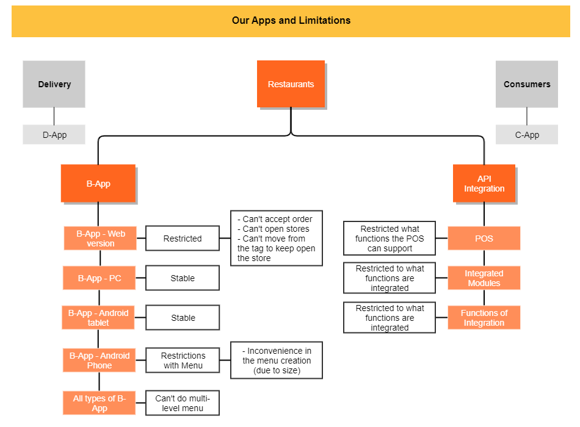

<!-- fonte: https://developer-food.99app.com/pt-BR/openapi · id 1877 · Common > Introduction > Introduction -->

## Introduction

The purpose of **99Food Open Platform** is to provide our partners with all the documentation related to the 99Food’s API and guide you through the whole integration, as well as the daily operation logic. Here you will:

* Understand the **process** to integrate 99Food’s API and the **requirements** for it.
* Understand the terminology used in our API in our **glossary**.
* See our **different APIs and webhooks** to manage authorization, orders, stores and menu configurations. 
* Download the **yaml file** to explore endpoints, methods and samples of API requests and responses.
* Have all the information to start **testing** your application.
* Understand how to take advantage of all tools in our **Application Management**.
* Understand the **operational process of 99Food** that can assist you in the daily operations management.
* Learn with our **FAQ**.

## Benefits of the Integration

With an integration with **99Food**, restaurants and POS will be able to incorporate the resources of their businesses with our platform. Our API is designed to allow you to integrate with our application as quickly and easily as possible.

As our partner, you’ll be able to see all the available endpoints that give you **control over how your application can integrate with our platform**, thus giving you control over your own development accounts, stores, menus, items and managing the orders. It's important to notice that our modules can be integrated independently, but we always recommend having all modules integrated to get the full benefits of our services.

Besides this, the integration is the only way to use the multi-level menu feature. You can check the limitations of our different B-App versions in the image below:

> **IMPORTANT:**
> This portal is always under continuous improvement and is subject to changes without any previous notice. All information contained in this website is shared to you in strict confidence, therefore, the restricted sections can't be shared with anyone that hasn't been authorized to access it. If another partner wants to have access to them, please have them contact 99Food directly.
