<!-- fonte: https://developer-food.99app.com/pt-BR/openapi · id 1879 · Common > Introduction > Tools Introduction -->

## Tools Introduction

### Our Tools

In this portal, under the **Application Management** tab at the top, we provide various tools to make it easier for partners to monitor integrated stores, orders, and APIs. The tools also provide a way for partners to bind new stores and change their configuration without having to send a request to our team and without having to develop a solution using our endpoints.

With our tools, you'll be able to:

* **Create, edit or connect** an app (Test and Production) to your company's profile
* **Create and check** information of a test store
* **Bind** new stores
* **Change** store's Operating Status, Auto Online/Offline Method and Order Acceptance Method
* **Monitor** integration performance by webhook, see responses and check for errors
* **Compare** store's performance under the same integration
* **Monitor** orders in real-time

We also provide a **Sandbox Environment** for developers to test data sent to the registered callback address.

All tool-related documentation is available under the Tools Introduction menu, organized by tool. To access these features, you must first create an account. See below for Sign-up and Sign-in instructions.

#### Creating an Account

When accessing the Portal for the first time, you will have to create you account. Check how to do it below:

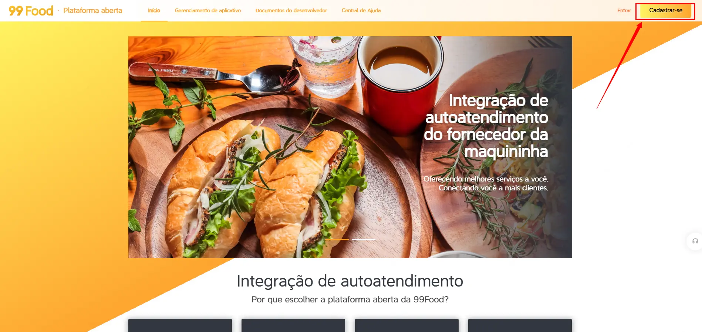
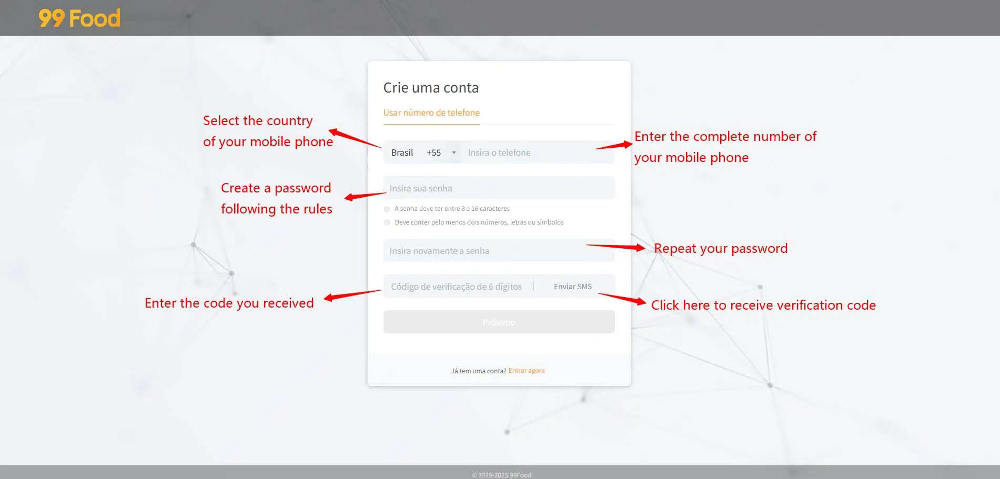

#### Sign in

After creating your account, you can sign in:

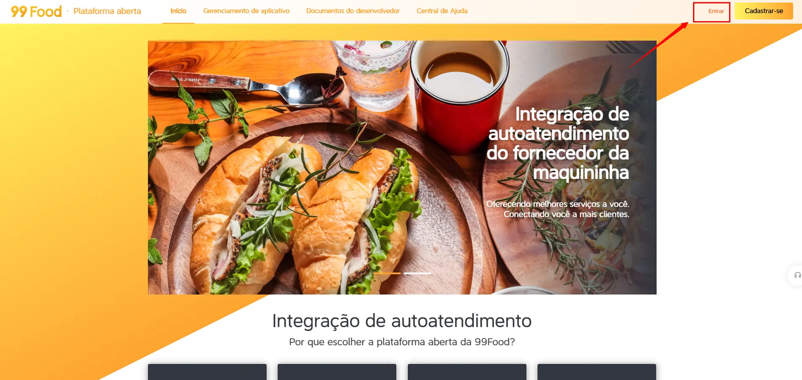
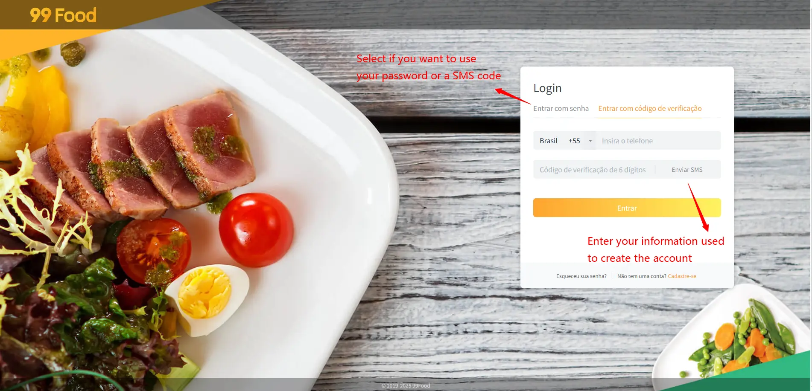

### Qualifications Management

Now that you have access to the Application Management section of the platform, we need you to apply for the  [Qualifications Management](https://developer.didi-food.com/en-US/app/qualifications/statistical). This will create an account for your company, where you can develop test and production apps for integration.

**Steps**:

1.  Fill out a form with your company information.
    -   Advisable: Use the same details as in your NDA.
    -   Our team will audit the information to approve or reject the application.
    -   Ensure completion of all prior steps in: **Integration Guide > Basic Process Overview > Phase 1: Pre-Process > Partners' Account Creation**.
2.  You’ll receive an audit result notification. If rejected, you may reapply or contact our team for details
3.  Without qualification, some tools remain inaccessible.
    

**After qualification, you can**:
-   Create test/production apps or connect legacy apps (for those created by 99Food before August 2021). → Guide: **Tools Introduction > Application Management**
-   Add users to manage apps (company-wide or specific apps). → Guide: **Tools Introduction > Permissions Management**

### Application Management

Now that you have your qualification approved, you can **create and administrate** your applications, the services developed with APIs in 99Food's system.

#### Creating an App

Enter Application Management tool and follow the steps below:

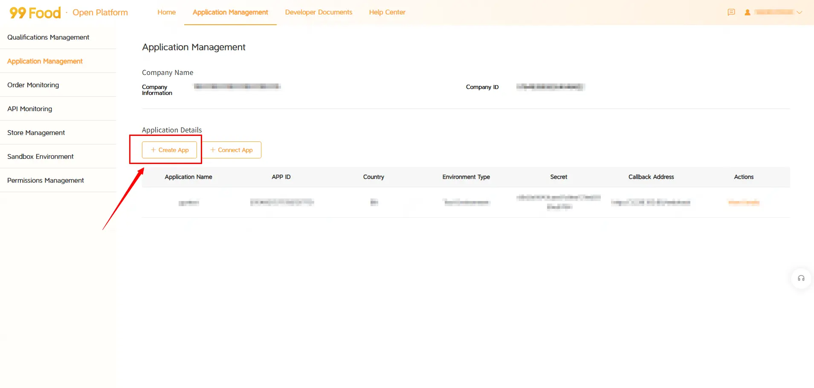
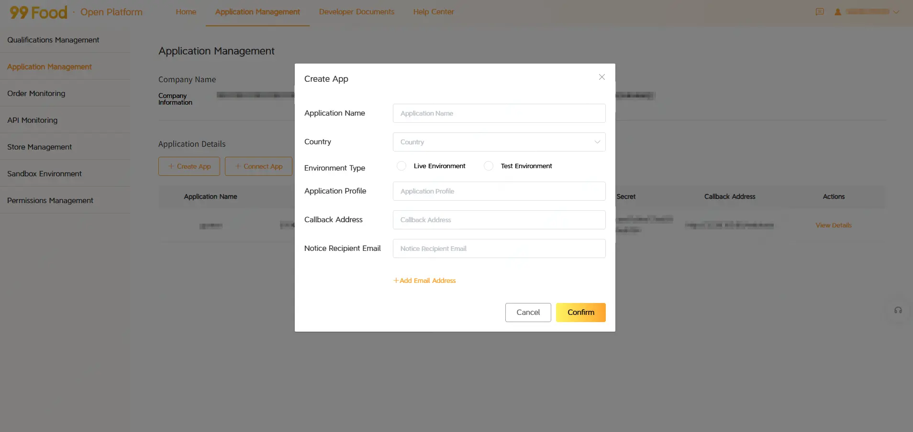

We ask you to follow a format for the **Application Name** that helps our operations team understand all the apps created and provide you with faster help: CountryCode_AppType_AppName (Usually the name of the POS or Restaurant). 
Ex: The testing app for McDonalds in Brazil = BR_T_McDonalds.

| **Country** | **CountryCode** | 
|-------------|-----------------|
| Brazil      | BR              |

| **AppType** | **Environment**        | 
|-------------|------------------------|
| T           | Test environment       |
| P           | Production environment |

> **NOTE**:
> After creating the app, you may want to grant access to other collaborators. See **Tools Introduction > Permissions Management** for details.

#### Connecting an App

If your app was created before August 2021, you may not have access to it in this management area. To proceed:
1.  Complete the steps in Qualifications Management (contact our team if unsure about your company's registration status).
2.  After your application is audited, you can connect your app by following the steps below and manage it through our portal.

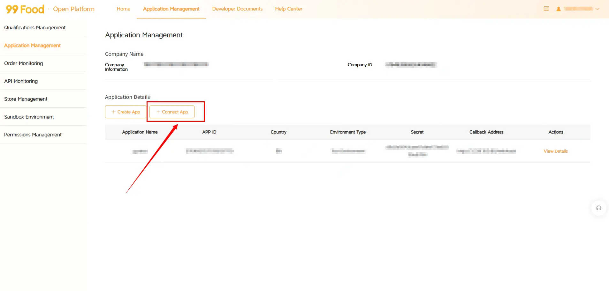
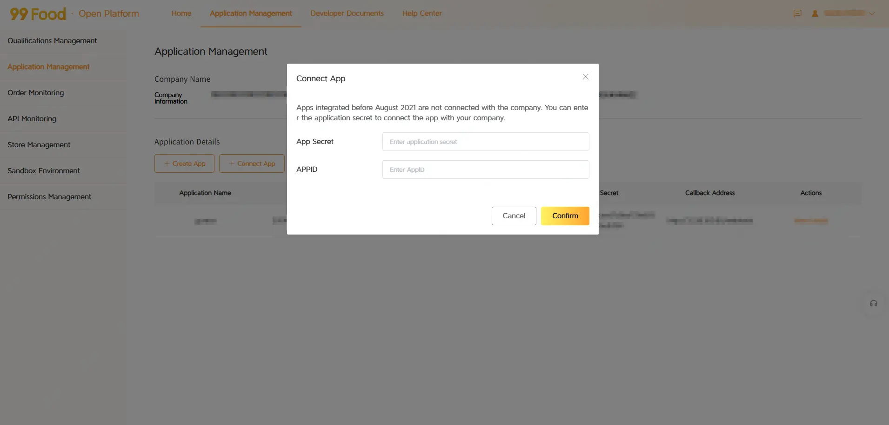

> **NOTE**:
> After connecting the app, you may want to give access to it to other collaborators. Check **Tools Introduction > Permissions Management** for that.

#### Editing an App

After creating or connecting an app, you can edit some of its details. To do so:
1.  Click **View Details** for the app you want to modify in the apps list
2.  Click **Edit** to change:
    -   Application name
    -   Application Profile
    -   Callback address
    -   Notice Recipient Email
    -   You can also add other email addresses to receive notice
3.  Click **Confirm** to save your changes

#### Adding a Test Store

You can create your own test store following the steps below (**IMPORTANT:** It has to be a Test Environment).
After creation, you can grant other users access to this store:
1.  Navigate to **Store Management**
2.  Click **Edit** on the target store
3.  In the **Set Store Manager** field, enter the user's phone number
4.  Click **Confirm** to save
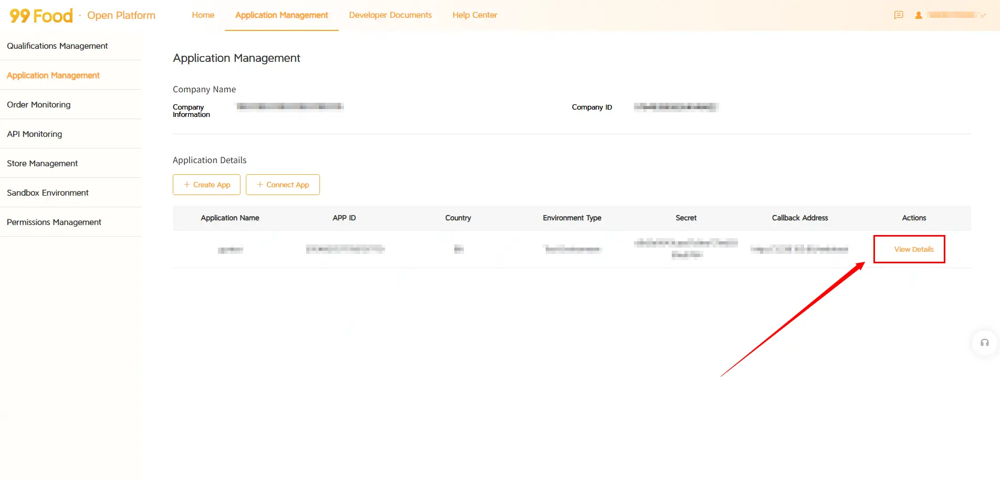
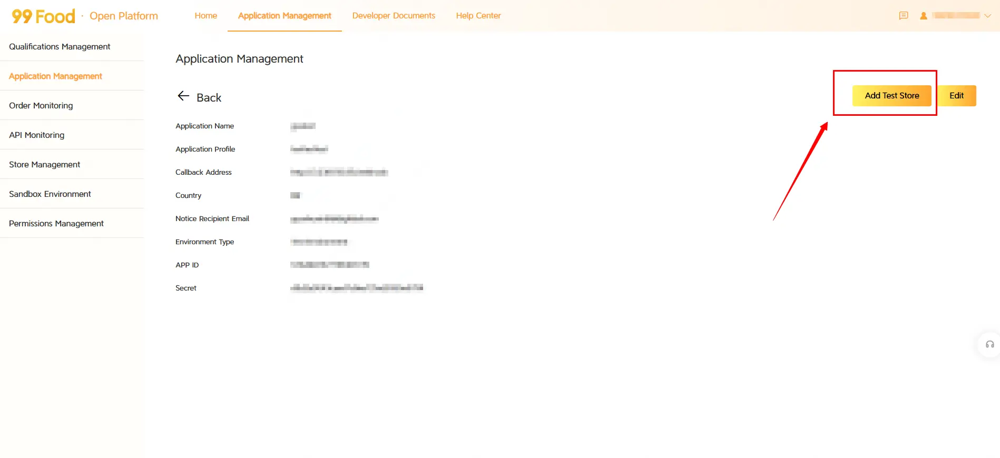
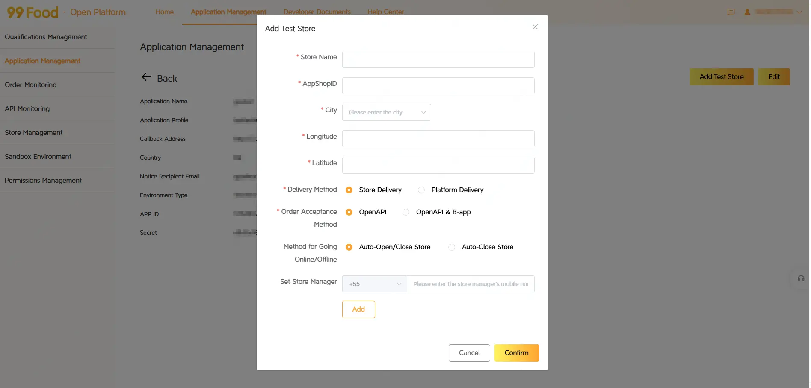

### Order Monitoring

In the section for [Order Monitoring](https://developer.didi-food.com/en-US/app/order/app) you have 3 tools to monitor the orders of the integrated stores on your application:

#### Real-time Monitoring

In the **Real-time Monitoring** panel:
1.  Select time zone
2.  Choose the target application
3.  Enter the exact App ShopID to identify a specific store
4.  Select unit of time to configure data aggregation level
5.  Click Search to monitor the store's real-time order performance

#### Store List

In the **Store List** panel, you'll be able to compare the performance of all the stores of an app, by status on a selected period (limited to the last 7 days).

#### Store Order Monitoring

In the **Store Order Monitoring** panel, you'll see a list of all orders from a specific store with their status from the past 7 days

### API Monitoring

In the  [API Monitoring](https://developer.didi-food.com/en-US/app/api/statistical) section, you have two real-time monitoring tools for API calls:

#### API Statistics Monitoring

This tool displays API call statistics, including:
-   Number of calls
-   Number of Successful Calls
-   Number of Failed Calls
-   Number of Timeouts
-   Success Rate

#### API Log Monitoring

This tool provides a user-friendly interface for troubleshooting, featuring:
-   Error logs
-   Sent values
-   Received values

### Store Management

In the section [Store Management](https://developer.didi-food.com/en-US/app/store/statistical) we provide:
1.  **Batch Store Management**: A tool for batch managing stores already integrated with your app
2.  **Store Binding**: A tool for batch binding stores to your app
Developers can grant the operations team access to these tools, enabling them to accelerate the store binding and configuration process. For details, see **Tools Introduction > Permissions Management**.

#### Batch Store Management

With the [Batch Store Management](https://developer.didi-food.com/en-US/app/store/batch) tool, you and your team will be able to modify basic configurations for integrated stores without using API endpoints. Here are all the configurations that can be set/changed with the tool:

1.  **Delivery Method:**  Choose the delivery method as either **Store Delivery** or **Platform Delivery**.
2.  **Order Acceptance Method:**  Change how stores accept orders - via B-App or OpenAPI. We recommend integrating the store first with B-App, then switching to OpenAPI after 2 days of successful operation.
3.  **Method for Going Online/Offline**  (only affects stores using OpenAPI order acceptance):

    - Auto-open/close store: The store opens and closes automatically according to its configured hours. (We recommend this option for integrated stores.)
    -  Auto-close store: The store closes automatically based on its schedule and must be reopened manually.
4.  **Set Store Manager**: You can add a user's phone number here to grant manager access.
> **NOTE:** You may want to check the following endpoints too: **Store API > Set Store Status** and **Store API > Set Store Order Confirmation Method**.

##### Resources

If you have members on your team that need to do these configurations without using the integration, you can send the [tutorial](../../attachments/cb397215dd/) after giving access to them to the app.

#### Store Binding
This tool generates a URL for store administrators to authorize bulk binding of multiple stores. After authorization, complete the binding process manually. This is the best method if you are working with a restaurant chains or businesses with multiple stores.
You can also perform store binding through the API interface, refer to: **Authorization API > Get Authorization Web PageStore** and **Store API > Bind Store/Unbind Store**
Check below the step by step to generate the link and complete the binding:
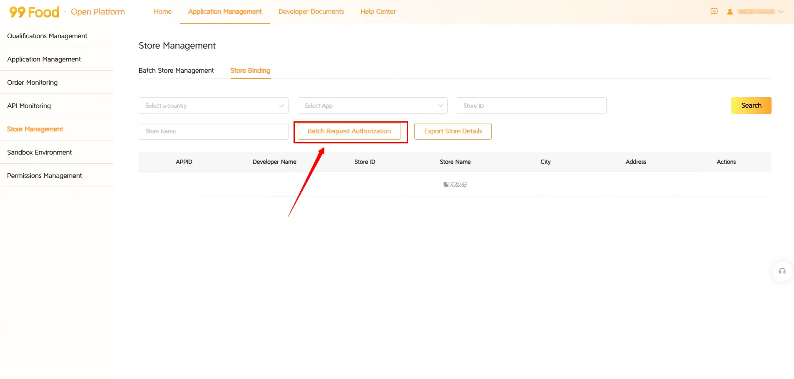
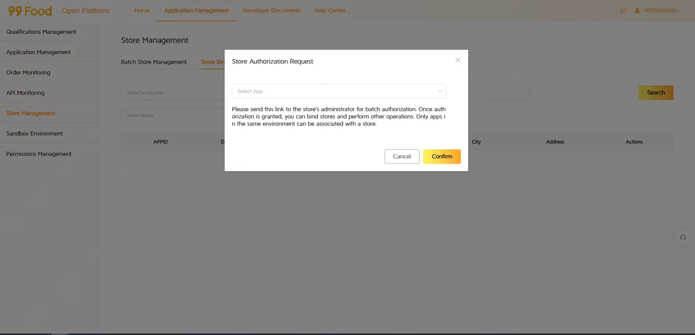
>**NOTE:** After completing the binding, it's important to check its status (**Store API > Set Store Status**) and its order confirmation method (**Store API > Set Store Order Confirmation Method**). You can do these 2 configurations using our [Batch Store Management](https://developer-food.99app.com/en-US/app/store/statistical) too.

##### Resources
You can send the [tutorial](../../attachments/7edbf0930f/) for the store to follow the steps and complete the authorization.

### Sandbox Environment

Our **Sandbox Environment** is a great tool for order simulation and verification. With it, you can receive orderNew, orderFinish, and orderCancel notifications at your callback address. You may even use a real app_item_id to verify whether the POS system correctly processes the order information. Refer to the following usage instructions:

> **ATTENTION:**
> These are only to test the injection of the information and you can't test the response to these webhooks. To test the whole order flow, please check the other method of testing: **Testing and Debugging >  Testing the Integration**.

### Permissions Management

Company account administrators can add other users to access our tools and manage their information. To do so, go to the **Permissions Management** section.
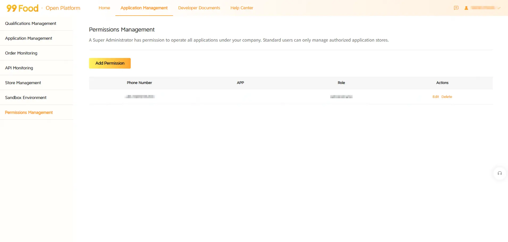
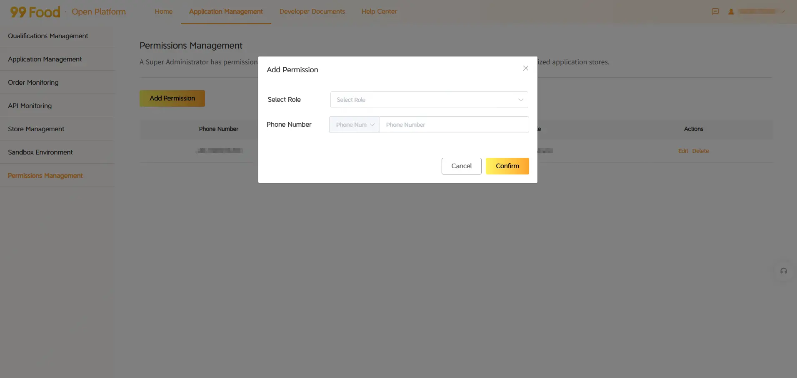
If you haven't added any user yet, the only information you'll see here is your information. Now you can click on **Add Permissions** to add new users, and then, you will be able to select the role:
-   **Administrator**: Adding a new administrator will give them the same permissions as you have. They will be able to create and connect apps and see their information, create test stores, operate stores and use the monitoring and sandbox tools. They will also be able to add and edit new administrators and standard users. We recommend granting this permission to developers and product team members in the integration project. Administrators can view, edit and operate all apps of the company.
-   **Standard User**: If you select the Standard User permission, a new field appears to assign specific company apps. This permission will give them the ability to use **Order Monitoring**, **API Monitoring** and **Store Management** tools for the selected apps. We recommend that you add the operators of the stores as users, so they can perform store binding and management operations.

### Q&A System

#### FAQ

We continuously update our **FAQ** section to provide the latest information. If you have any questions, please check the FAQ first. It's organized by major topics and subtopics for easy navigation and quick access to answers.

