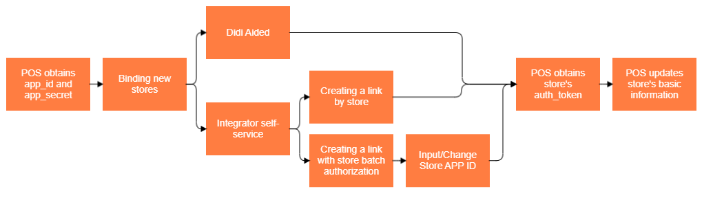

<!-- fonte: https://developer-food.99app.com/pt-BR/openapi · id 1915 · Food > 99Food Protocol (Recommended) > API Guide > Store Module -->

## Store Module

The **Store Module** provides features for managing stores. We call a store or shop the establishment that offers dishes/products on 99Food’s platform.

### Store Integration and Authorization Process

### What can be done with the store module

With this module, partners will be able to:

* **Get Store Details:** Retrieve comprehensive store information from our system, including:
    *   **Identifiers & Basics:** Store IDs, names, business category, and status.
    *   **Location & Visuals:** Address, images, and photos.
    *   **Operating Schedule:** Opening and closing hours, operating dates, and average food preparation time.
    *   **Settings:** Configuration for automatic open/close switches.
* **Update Store Information:** Modify a subset of the store's basic details and operational settings.
* **Set Store Status:** Set if the store is online/offline and how the status should switch.
* **Bind a store:** Associate a new store with your application using the dedicated endpoint.
* **Unbind a store:** Remove a store's association from your application using the dedicated endpoint.
* **Set Store Order Confirmation Method:** Set or change between the 2 methods we provide for integrated stores to confirm their orders. 
* **Update Delivery Area:** Configure the store delivery areas used in the store-delivery business model.
* **Set Store Cancellation/Refund:** Set if a store accepts or not cancellation and refunds.

> **IMPORTANT:**
> All new stores shall have passed 99Food's audit process and have the commercial and cooperation agreements in signed status to be able to be integrated.

### APIs and Callbacks

| **Name** | **Type** | **Function** |
| --- | --- | --- |
| `/shop/shop/bind/` | Endpoint | bind a store from an app |
| `/shop/shop/unbind/` | Endpoint | Unbind a store from an app |
| `/shop/shop/setconfirmmethod/` | Endpoint | Set store's order confirmation method |
| `/shop/shop/detail/` | Endpoint | Get store's details |
| `/shop/shop/update/` | Endpoint | Update store's basic information |
| `/shop/shop/validCategories/` | Endpoint | Get valid categories for stores |
| `/shop/shop/setStatus/` | Endpoint | Change the status of a store |
| `/shop/apply/set/` | Endpoint | Configure if a store accepts cancellations and refunds |
| `/shop/deliveryArea/add/` | Endpoint | Add a delivery area for store's self delivery service |
| `/shop/deliveryArea/update/` | Endpoint | Update a delivery area for store's self delivery service |
| `/shop/deliveryArea/delete/` | Endpoint | Delete one or more delivery areas for a store |
| `/shop/deliveryArea/list/` | Endpoint | Get all delivery areas set to a store |
| `/shop/shop/list/` | Endpoint | List all stores bound to an app |
| `authorization/getAuthorizedShops` | Endpoint | provides the ability to get the authorized stores under the app in page |
| `shopStatus` | Callback | Notify when the `biz_status` of a store changes |
| `imageAuditStatus` | Callback | Notify the result of uploading images to a store |
