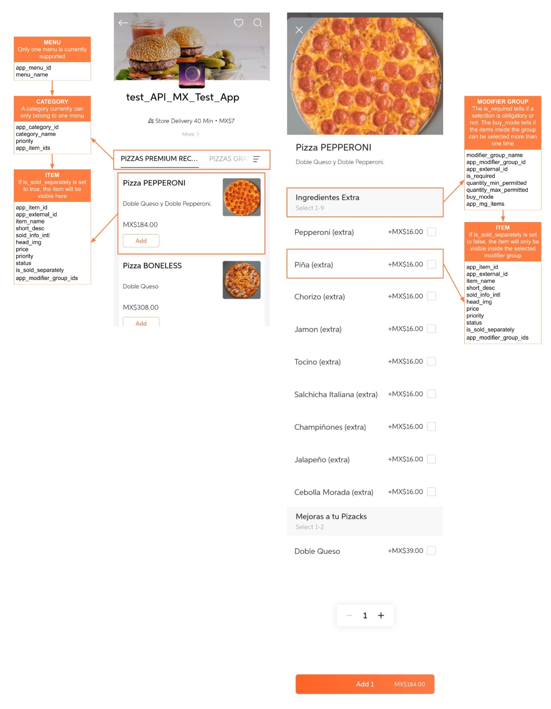

<!-- fonte: https://developer-food.99app.com/pt-BR/openapi · id 1917 · Food > 99Food Protocol (Recommended) > API Guide > Menu Module -->

## Menu Module

The **Menu Module** gives our partners a way to synchronize and manage the menu in our platform. For that, it is essential to understand the menu definition and how to use it, so that the 99Food platform's menu can be mapped easily to the partner's system.

The main benefits of this API are to **decrease the time** to upload and change the menu that, otherwise, has to be handled manually in our B-App.

### What can be done with menu module

With this module, partners will be able to:

* **Get Store Menu Details:** Retrieve the complete menu structure and all its details for a store.
* **Upload Store Menu Details:** Asynchronously create or replace a store's entire menu.
* **Update One Item:** Modify the detailed information of a single menu item.
* **Update Item Status:** Change the availability status of an item.
* **Update Modifier Group:** Modify a modifier group and the items within it.

### Sample of the menu model

### APIs and Callbacks

| **Name**                                   | **Type** | **Function**                                                                   |
|--------------------------------------------|----------|--------------------------------------------------------------------------------|
| `/item/item/list/`                         | Endpoint | Get a store's menu                                                             |
| `/item/item/upload/`                       | Endpoint | Upload an entire menu to a store                                               |
| `/item/item/getMenuTaskInfo/`              | Endpoint | Get a detailed error info for the uploading menu task                          |
| `/item/item/updateItem/`                   | Endpoint | Update a single item's information                                             |
| `/item/item/updateItemStatus/`             | Endpoint | Update the availability of an item                                             |
| `/item/item/updateModifierGroup/`          | Endpoint | Update a modifier group and its items                                          |
| `/image/image/uploadImage/`                | Endpoint | Upload image to our storage service                                            |
| `/image/image/getImageUploadInfoPageList/` | Endpoint | Get the image urls on our storage services                                     |
| `uploadMenuTaskStatus`                     | Callback | Notify when the status of a upload menu task changes with detailed information |
| `imageAuditStatus`                         | Callback | Notify the result of uploading menu images                                     |
