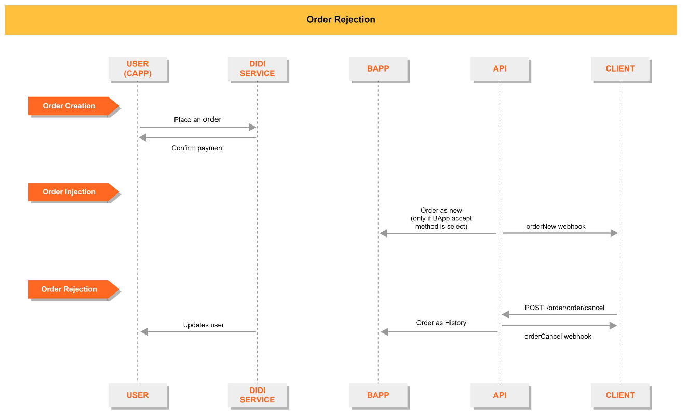
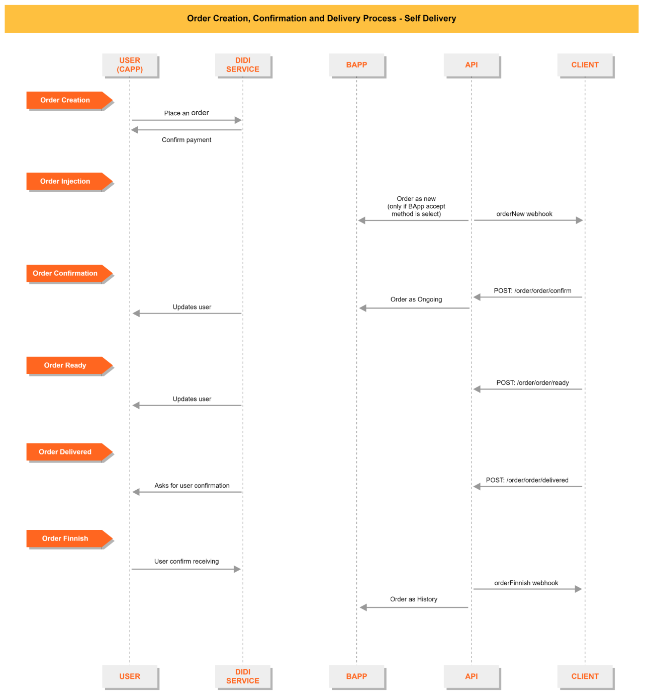
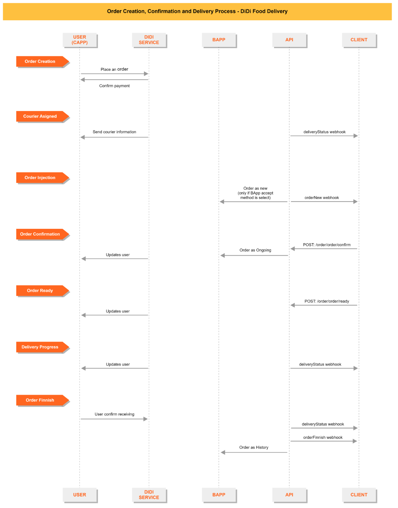
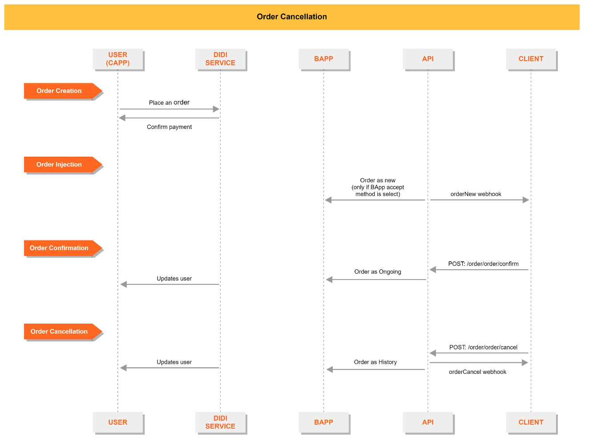
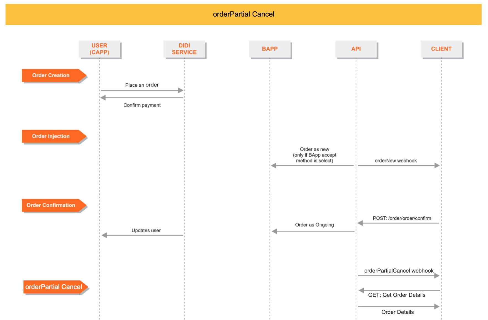

<!-- fonte: https://developer-food.99app.com/pt-BR/openapi · id 2087 · Grocery > API Guide > Orders Module -->

## Orders Module
 
The **Orders Module** gives our partners a way to manage and track every stage of an order. For a seamless operational experience, we strongly recommend integrating with all order statuses to avoid any gaps in process flow.

### What can be done with orders module

- **Get Order Details:** Retrieve the complete information for a specific order.
- **Confirm Order:** Send a confirmation that the store has accepted and started preparing the order.
- **Cancel Order:** Cancel an order if the store is unable to fulfill it.
- **Handle Cancellation Requests:** Respond to cancellation requests initiated by the customer.
- **Handle Refund Requests:** Respond to refund requests initiated by the customer.

### 99Food’s and POS responsibilities in the order processing

The below process chart shows each role's task during an order process in case of confirmation or cancellation:

### APIs and Callbacks

| **Name**                  | **Type** | **Function**                                                       |
|---------------------------|----------|--------------------------------------------------------------------|
| `/order/order/detail/`    | Endpoint | Get complete information for a single order                            |
| `/order/order/confirm/`   | Endpoint | API to confirm an order                                            |
| `/order/order/cancel/`    | Endpoint | API to cancel an order                                             |
| `/order/apply/cancel/`    | Endpoint | API to agree or refuse a cancellation request raised by the customer |
| `/order/apply/refund/`    | Endpoint | API to agree or refuse a refund request raised by the customer       |
| `/order/order/ready/`     | Endpoint | API to inform that the meal is prepared                               |
| `/order/order/delivered/` | Endpoint | API to inform that the delivery has been completed                    |
| `order/order/verify/`     | Endpoint | API to check whether the amount of money is within a reasonable range.                    |
| `orderNew`                | Callback | Notify a new order                                                 |
| `orderCancel`             | Callback | Notify when an order has been canceled                            |
| `orderFinish`             | Callback | Notify when an order is completed                                 |
| `deliveryStatus`          | Callback | Notify when delivery status of an order has changed                |
| `orderCancelApply`        | Callback | Notify of a customer's order cancellation request                  |
| `orderRefundApply`        | Callback | Notify of a customer's order refund request                                  |
| `orderPartialCancel`      | Callback | Notify when an order is partially canceled                                 |
