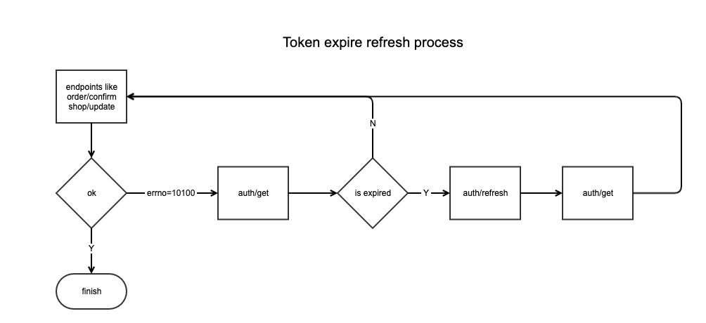

<!-- fonte: https://developer-food.99app.com/pt-BR/openapi · id 2097 · Grocery > Authorization API > Get Authtoken -->

## Get Authtoken

The **Get Authtoken** endpoint will return the `auth_token` for the requested store.
The `auth_token` is generated with a random expiration date, so we suggest a constant check to see if the refresh process is necessary.
Before using this API, create the application to obtain app_id and app_secret, and use app_shop_id to bind the store.



### Basic Information

| **Name** | **Description** |
| --- | --- |
| `URL` | [https://openapi.99food.com/v1/auth/authtoken/get](https://openapi.99food.com/v1/auth/authtoken/get) |
| `Method` | GET |
| `Permission` | Available |


### Request Path Parameters

| **Name** | **Type** | **Required** | **Description** | **Example** |
| --- | --- | --- | --- | --- |
| `app_id` | long | Yes | The ID of an app in **our** system. | 1152921557674426642 |
| `app_secret` | string | Yes | The secret key of `app_id`. | b0919c644bddc031c59288884954cf5c |
| `app_shop_id` | string | Yes | The **unique** store identifier in **your** system. Must not be duplicate or blank. | 3423432 |


### Response Body Parameters

| **Name** | **Type** | **Description** |
| --- | --- | --- |
| `app_id` | long | The ID for an app in **our** system.|
| `app_shop_id` | string | The **unique** store identifier in **your** system.|
| `auth_token` | string |The `auth_token` for the shop.|
| `token_expiration_time` | int | The `auth_token` expiration datetime. If the `auth_token` expires, you can create another with the **Refresh Authtoken API**. |

### Rate Limit
| **API Name** | **Endpoint** | **Limit** |
| --- | --- | --- |
| `Get Authtoken` | v1/auth/authtoken/get | 1req/30s |

### Response Errors (errno) Descriptions

| **Code** | **Description** |
| --- | --- |
| 10001 | System error. |
| 10002 | Parameter error. |
| 10100 | Get `auth_token` failed. |
| 10101 | This shop does not have `auth_token`. |
| 10102 | `auth_token` has expired. Please refresh it. |
| 14103 | Get app failed. |
| 14105 | `app_id` does not exist. |
| 14106 | `app_secret` is wrong. |

### Response Example

```json
{
    "errno":0,
    "errmsg":"ok",
    "requestId":"228b4ae26f25664a",
    "time":1568710223,
    "data":{
        "app_id":1152921557674426642,
        "app_shop_id":"3423432127",
        "auth_token":"ZGQ5ZjVlZGUyYmFhNDM2ZmE0ZDA5OTE5ZjI1YzBhNjU=",
        "token_expiration_time":1570092313
    }
}
```